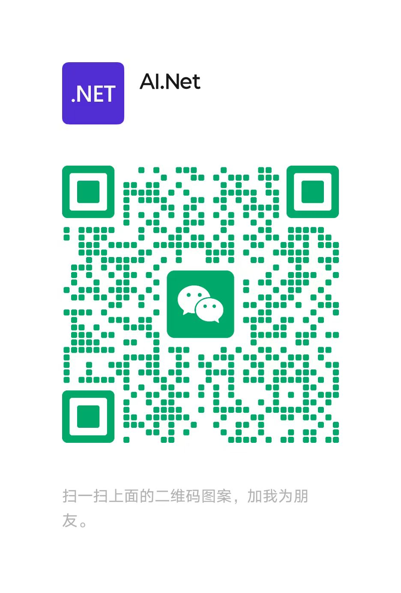

## WeChatAuto.SDK VIP

<table>
  <tr>
    <td width="900">
      <strong>WeChatAuto.SDK VIP</strong>
      <span>年度订阅</span>

      <h1>¥499</h1>

      <p>/ 年</p>

      <p>让微信 Agent 开发更高效、更省心。</p>

      <hr>

      <ul>
        <li>社区版：核心能力开源，免费使用</li>
        <li>VIP 版：解锁 VIP 专属功能与权益</li>
        <li>具体功能：查看社区版与 VIP 版功能对比</li>
      </ul>
    </td>
  </tr>
</table>
</table>

> [!IMPORTANT]
> 如需升级成为 VIP，或了解 VIP 具体权益和支持方案，请加我为好友,
> 
> 烦请备注 ```wechatauto``` ，方便机器人自动通过，非常感谢支持与理解！ 




